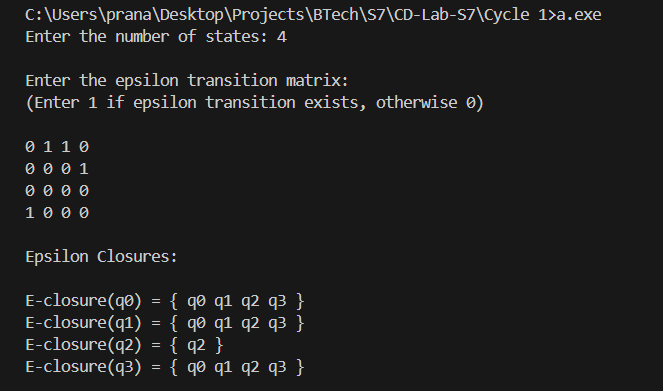

# Compiler Lab Experiment 1

Aim: To write a C program to find the ε — closure of all states of any given NFA with ε transition.

## Algorithm

1. Start.
2. Read the number of states `n`.
3. Read the ε-transition matrix of size `n × n`.
4. For each state `qi` from `q0` to `q(n-1)`, initialize the `closure` array to `0`.
5. Select state `qi` as the starting state.
6. Add the selected state to its ε-closure by marking `closure[i] = 1`.
7. Check all states `qj` from `q0` to `q(n-1)`.
8. If `matrix[i][j] == 1`, an ε-transition exists from `qi` to `qj`.
9. Check whether `qj` is already included in the closure.
10. If `qj` is not included, mark `closure[j] = 1`.
11. Recursively find the ε-closure of `qj`.
12. Repeat Steps 7–11 until all reachable states through ε-transitions have been visited.
13. Display all states whose corresponding `closure` value is `1`.
14. This gives the ε-closure of the selected state.
15. Reset the `closure` array for the next state.
16. Repeat Steps 5–15 for all `n` states.
17. Stop.

## Program

```c
#include <stdio.h>

#define MAX 20

int matrix[MAX][MAX];
int closure[MAX];
int n;

void epsilon_closure(int state)
{
    int i;

    closure[state] = 1;

    for (i = 0; i < n; i++)
    {
        if (matrix[state][i] == 1 && closure[i] == 0)
        {
            epsilon_closure(i);
        }
    }
}

int main()
{
    int i, j;

    printf("Enter the number of states: ");
    scanf("%d", &n);

    printf("\nEnter the epsilon transition matrix:\n");
    printf("(Enter 1 if epsilon transition exists, otherwise 0)\n\n");

    for (i = 0; i < n; i++)
    {
        for (j = 0; j < n; j++)
        {
            scanf("%d", &matrix[i][j]);
        }
    }

    printf("\nEpsilon Closures:\n");

    for (i = 0; i < n; i++)
    {
        for (j = 0; j < n; j++)
        {
            closure[j] = 0;
        }

        epsilon_closure(i);

        printf("\nE-closure(q%d) = { ", i);

        for (j = 0; j < n; j++)
        {
            if (closure[j] == 1)
            {
                printf("q%d ", j);
            }
        }

        printf("}");
    }

    printf("\n");

    return 0;
}
```

## Output


