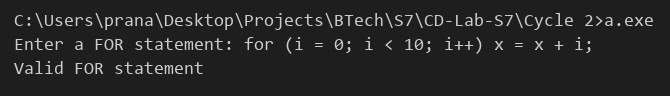

# Compiler Lab Experiment 10

Aim: Write a YACC program to check the syntax of the FOR statement in C.

## Algorithm

1. Start.
2. Declare the tokens `FOR`, `INT`, `ID`, `NUM`, `RELOP`, `INC` and `DEC`.
3. Write the grammar rule for the statement:
   - `stmt -> FOR ( init ; cond ; incr ) body`
4. Write the rules for the three parts. Each part may also be empty.
   - `init -> INT ID = expr | ID = expr`
   - `cond -> expr RELOP expr`
   - `incr -> ID INC | ID DEC | INC ID | DEC ID | ID = expr`
5. Write the rules for the body, which is a single statement or a block of statements in `{ }`:
   - `body -> simple | { list }`
   - `simple -> ID = expr ; | ;`
6. Write the rule for expressions using operands (`ID` or `NUM`) and the operators `+ - * /`.
7. In `yylex()`, read words and return `FOR`, `INT` or `ID`. Return `NUM` for numbers, `RELOP` for `< > <= >= == !=` and `INC` / `DEC` for `++` / `--`.
8. In `main()`, call `yyparse()`.
9. If the input matches the rule `stmt`, display `Valid FOR statement`.
10. Otherwise, `yyerror()` displays `Invalid FOR statement`.
11. Stop.

## Program

```yacc
%{
#include <stdio.h>
#include <stdlib.h>
#include <string.h>
#include <ctype.h>
int yylex();
int yyerror(const char *s);
%}
%token FOR INT ID NUM RELOP INC DEC
%%
stmt    : FOR '(' init ';' cond ';' incr ')' body '\n'
            { printf("Valid FOR statement\n"); exit(0); }
        ;
init    : INT ID '=' expr
        | ID '=' expr
        |
        ;
cond    : expr RELOP expr
        |
        ;
incr    : ID INC
        | ID DEC
        | INC ID
        | DEC ID
        | ID '=' expr
        |
        ;
body    : simple
        | '{' list '}'
        ;
list    : list simple
        |
        ;
simple  : ID '=' expr ';'
        | ';'
        ;
expr    : operand
        | expr '+' operand
        | expr '-' operand
        | expr '*' operand
        | expr '/' operand
        ;
operand : ID
        | NUM
        ;
%%
int main()
{
    printf("Enter a FOR statement: ");
    yyparse();
    return 0;
}
int yylex()
{
    int c, d, i = 0;
    char w[30];
    while ((c = getchar()) == ' ' || c == '\t');
    if (isalpha(c))
    {
        while (isalnum(c))
        {
            w[i++] = c;
            c = getchar();
        }
        w[i] = '\0';
        ungetc(c, stdin);
        if (strcmp(w, "for") == 0)
            return FOR;
        if (strcmp(w, "int") == 0)
            return INT;
        return ID;
    }
    if (isdigit(c))
    {
        while (isdigit(c))
            c = getchar();
        ungetc(c, stdin);
        return NUM;
    }
    if (c == '<' || c == '>' || c == '=' || c == '!')
    {
        d = getchar();
        if (d == '=')
            return RELOP;
        ungetc(d, stdin);
        if (c == '<' || c == '>')
            return RELOP;
        return c;
    }
    if (c == '+' || c == '-')
    {
        d = getchar();
        if (d == c)
            return (c == '+') ? INC : DEC;
        ungetc(d, stdin);
        return c;
    }
    if (c == EOF)
        return 0;
    return c;
}
int yyerror(const char *s)
{
    printf("Invalid FOR statement\n");
    exit(0);
}
```

## Execution

```
bison Exp_10.y
gcc Exp_10.tab.c
a.exe
```

## Output


