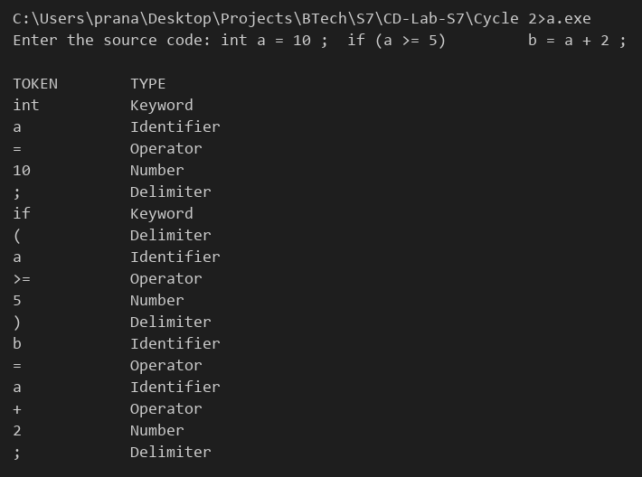

# Compiler Lab Experiment 5

Aim: Design and implement a lexical analyzer for a given language using C. The lexical analyzer should ignore redundant spaces, tabs and newlines.

## Algorithm

1. Start.
2. Define the keywords of the language: `int`, `float`, `char`, `if`, `else`, `while`, `for`, `return`.
3. Read the source code into the string `code`.
4. Set `i = 0` and repeat Steps 5–11 until the end of `code` is reached.
5. If `code[i]` is a space, tab or newline, ignore it and move to the next character.
6. If `code[i]` is a letter or underscore, read all following letters, digits and underscores into `word`.
7. Compare `word` with the keyword list. If it matches, display it as a `Keyword`, otherwise display it as an `Identifier`.
8. If `code[i]` is a digit, read all following digits into `word` and display it as a `Number`.
9. If `code[i]` is one of `+ - * / % = < > !`, read it as an operator. If the next character is `=` (for `==`, `<=`, `>=`, `!=`), read it also. Display it as an `Operator`.
10. If `code[i]` is one of `( ) { } [ ] ; ,`, display it as a `Delimiter`.
11. Otherwise, display the character as `Invalid`.
12. Stop.

## Program

```c
#include <stdio.h>
#include <ctype.h>
#include <string.h>
int isKeyword(char *s)
{
    char *keywords[] = {"int", "float", "char", "if", "else", "while", "for", "return"};
    int i;
    for (i = 0; i < 8; i++)
        if (strcmp(s, keywords[i]) == 0)
            return 1;
    return 0;
}
int main()
{
    char code[200], word[50];
    int i = 0, j;
    printf("Enter the source code: ");
    fgets(code, 200, stdin);
    printf("\nTOKEN        TYPE\n");
    while (code[i] != '\0')
    {
        if (code[i] == ' ' || code[i] == '\t' || code[i] == '\n')
            i++;
        else if (isalpha(code[i]) || code[i] == '_')
        {
            j = 0;
            while (isalnum(code[i]) || code[i] == '_')
                word[j++] = code[i++];
            word[j] = '\0';
            if (isKeyword(word))
                printf("%-12s Keyword\n", word);
            else
                printf("%-12s Identifier\n", word);
        }
        else if (isdigit(code[i]))
        {
            j = 0;
            while (isdigit(code[i]))
                word[j++] = code[i++];
            word[j] = '\0';
            printf("%-12s Number\n", word);
        }
        else if (strchr("+-*/%=<>!", code[i]))
        {
            word[0] = code[i++];
            word[1] = '\0';
            if (code[i] == '=' && strchr("=<>!", word[0]))
            {
                word[1] = '=';
                word[2] = '\0';
                i++;
            }
            printf("%-12s Operator\n", word);
        }
        else if (strchr("(){}[];,", code[i]))
        {
            printf("%-12c Delimiter\n", code[i]);
            i++;
        }
        else
        {
            printf("%-12c Invalid\n", code[i]);
            i++;
        }
    }
}
```

## Output


