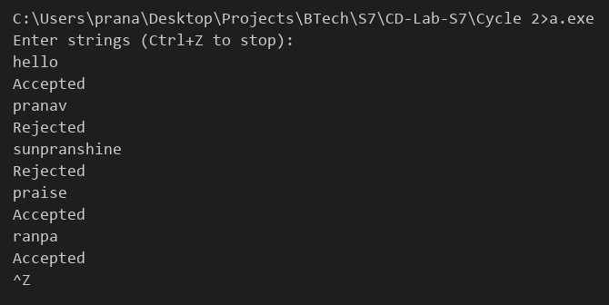

# Compiler Lab Experiment 6

Aim: Write a lex program to recognize all strings which do not contain the first four characters of your name as a substring.

## Algorithm

1. Start.
2. Take the first four characters of the name (Pranav) as the pattern `pran`.
3. In the rules section, define the pattern `.+` to match every line of input.
4. When a line is matched, its text is available in `yytext`.
5. Search for `pran` in `yytext` using `strstr()`.
6. If `pran` is not found, display `Accepted`.
7. If `pran` is found, display `Rejected`.
8. Ignore the newline character.
9. In `main()`, call `yylex()` to start scanning the input.
10. Stop.

## Program

```lex
%{
#include <stdio.h>
#include <string.h>
%}
%option noyywrap
%%
.+      {
            if (strstr(yytext, "pran") == NULL)
                printf("Accepted\n");
            else
                printf("Rejected\n");
        }
\n      ;
%%
int main()
{
    printf("Enter strings (Ctrl+Z to stop):\n");
    yylex();
    return 0;
}
```

## Execution

```
flex Exp_6.l
gcc lex.yy.c
a.exe
```

Note: The name used is Pranav, so the forbidden substring is `pran` (lowercase). Change it in the `strstr()` call for another name.

## Output


