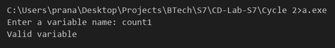

# Compiler Lab Experiment 7

Aim: Write a YACC program to recognize a valid variable which starts with a letter followed by any number of letters or digits.

## Algorithm

1. Start.
2. Declare the tokens `LETTER` and `DIGIT`.
3. Write the grammar rules:
   - `start -> var '\n'`
   - `var -> LETTER rest`
   - `rest -> LETTER rest | DIGIT rest | ε`
4. In `yylex()`, read one character at a time using `getchar()`.
5. Return `LETTER` if the character is a letter, `DIGIT` if it is a digit, `0` at end of file and the character itself otherwise.
6. In `main()`, call `yyparse()` to read the variable name.
7. If the input reduces to `start`, display `Valid variable`.
8. If a syntax error occurs, `yyerror()` displays `Invalid variable`.
9. Stop.

## Program

```yacc
%{
#include <stdio.h>
#include <stdlib.h>
#include <ctype.h>
int yylex();
int yyerror(const char *s);
%}
%token LETTER DIGIT
%%
start : var '\n'    { printf("Valid variable\n"); exit(0); }
      ;
var   : LETTER rest
      ;
rest  : LETTER rest
      | DIGIT rest
      |
      ;
%%
int main()
{
    printf("Enter a variable name: ");
    yyparse();
    return 0;
}
int yylex()
{
    int c = getchar();
    if (isalpha(c))
        return LETTER;
    if (isdigit(c))
        return DIGIT;
    if (c == EOF)
        return 0;
    return c;
}
int yyerror(const char *s)
{
    printf("Invalid variable\n");
    exit(0);
}
```

## Execution

```
bison Exp_7.y
gcc Exp_7.tab.c
a.exe
```

## Output


