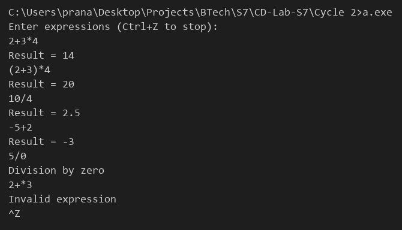

# Compiler Lab Experiment 8

Aim: Implementation of a calculator using LEX and YACC.

## Algorithm

1. Start.
2. In the LEX file, define a pattern for numbers (integers and decimals), convert the matched text to a value using `atof()` and return the token `NUMBER`.
3. Ignore spaces and tabs in the LEX file. Return newline and all other characters as they are.
4. In the YACC file, declare the token `NUMBER` and give the operators `+ -` lower precedence than `* /`. All of them are left associative.
5. Give unary minus the highest precedence.
6. Write the grammar rules for `expr`: `expr + expr`, `expr - expr`, `expr * expr`, `expr / expr`, `( expr )`, `- expr` and `NUMBER`.
7. For each rule, compute the value of the expression (`$$ = $1 + $3` etc.).
8. For division, if the divisor is `0`, display `Division by zero` and report an error.
9. For every line of the form `expr '\n'`, display the result.
10. If a syntax error occurs, display `Invalid expression` and skip to the next line.
11. Repeat the parsing for every input line until the end of input.
12. Stop.

## Program

**Exp_8.l**

```lex
%{
#include <stdlib.h>
#include "Exp_8.tab.h"
%}
%option noyywrap
%%
[0-9]+(\.[0-9]+)?   { yylval = atof(yytext); return NUMBER; }
[ \t]               ;
\n                  { return '\n'; }
.                   { return yytext[0]; }
%%
```

**Exp_8.y**

```yacc
%{
#include <stdio.h>
int yylex();
int yyerror(const char *s);
%}
%define api.value.type {double}
%token NUMBER
%left '+' '-'
%left '*' '/'
%right UMINUS
%%
input :
      | input line
      ;
line  : '\n'
      | expr '\n'     { printf("Result = %g\n", $1); }
      | error '\n'    { yyerrok; }
      ;
expr  : expr '+' expr { $$ = $1 + $3; }
      | expr '-' expr { $$ = $1 - $3; }
      | expr '*' expr { $$ = $1 * $3; }
      | expr '/' expr {
                          if ($3 == 0)
                          {
                              printf("Division by zero\n");
                              YYERROR;
                          }
                          $$ = $1 / $3;
                      }
      | '(' expr ')'  { $$ = $2; }
      | '-' expr %prec UMINUS { $$ = -$2; }
      | NUMBER
      ;
%%
int main()
{
    printf("Enter expressions (Ctrl+Z to stop):\n");
    yyparse();
    return 0;
}
int yyerror(const char *s)
{
    printf("Invalid expression\n");
    return 0;
}
```

## Execution

```
bison -d Exp_8.y
flex Exp_8.l
gcc Exp_8.tab.c lex.yy.c
a.exe
```

## Output


