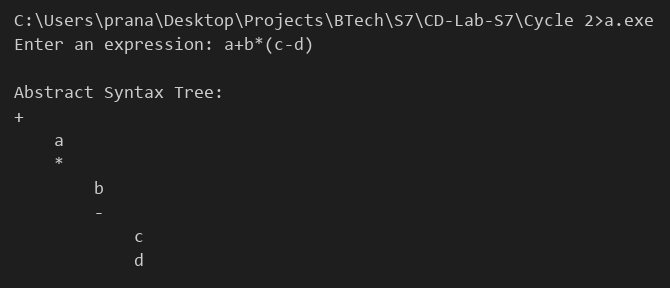

# Compiler Lab Experiment 9

Aim: Convert the BNF rules into YACC form and write code to generate an abstract syntax tree.

## Algorithm

1. Start.
2. Write the BNF rules of the expression grammar:
   - `expr -> expr + term | expr - term | term`
   - `term -> term * factor | term / factor | factor`
   - `factor -> ( expr ) | ID | NUM`
3. Convert these rules into YACC rules in the rules section.
4. Define a structure `node` with a label, a left pointer and a right pointer.
5. Write the function `newnode(label, left, right)` to create a new tree node.
6. In `yylex()`, skip spaces and read identifiers and numbers. Create a leaf node for each of them and store it in `yylval`.
7. In each rule with an operator, create a node with the operator as the label and the two operands as children (`$$ = newnode("+", $1, $3)`).
8. For `( expr )`, pass the node of the inner expression (`$$ = $2`).
9. When the full expression is reduced, call `printtree()` to display the tree. Each child is printed one level inside its parent.
10. Stop.

## Program

```yacc
%{
#include <stdio.h>
#include <stdlib.h>
#include <string.h>
#include <ctype.h>
struct node
{
    char label[20];
    struct node *left, *right;
};
#define YYSTYPE struct node *
int yylex();
int yyerror(const char *s);
struct node *newnode(char *label, struct node *l, struct node *r)
{
    struct node *p = (struct node *)malloc(sizeof(struct node));
    strcpy(p->label, label);
    p->left = l;
    p->right = r;
    return p;
}
void printtree(struct node *p, int level)
{
    int i;
    if (p == NULL)
        return;
    for (i = 0; i < level; i++)
        printf("    ");
    printf("%s\n", p->label);
    printtree(p->left, level + 1);
    printtree(p->right, level + 1);
}
%}
%token ID NUM
%%
stmt   : expr '\n'          { printf("\nAbstract Syntax Tree:\n"); printtree($1, 0); }
       ;
expr   : expr '+' term      { $$ = newnode("+", $1, $3); }
       | expr '-' term      { $$ = newnode("-", $1, $3); }
       | term
       ;
term   : term '*' factor    { $$ = newnode("*", $1, $3); }
       | term '/' factor    { $$ = newnode("/", $1, $3); }
       | factor
       ;
factor : '(' expr ')'       { $$ = $2; }
       | ID
       | NUM
       ;
%%
int main()
{
    printf("Enter an expression: ");
    yyparse();
    return 0;
}
int yylex()
{
    int c, i = 0;
    char w[20];
    while ((c = getchar()) == ' ' || c == '\t');
    if (isalnum(c))
    {
        int isnum = isdigit(c);
        while (isalnum(c))
        {
            w[i++] = c;
            c = getchar();
        }
        w[i] = '\0';
        ungetc(c, stdin);
        yylval = newnode(w, NULL, NULL);
        return isnum ? NUM : ID;
    }
    if (c == EOF)
        return 0;
    return c;
}
int yyerror(const char *s)
{
    printf("Syntax error\n");
    return 0;
}
```

## Execution

```
bison Exp_9.y
gcc Exp_9.tab.c
a.exe
```

## Output


