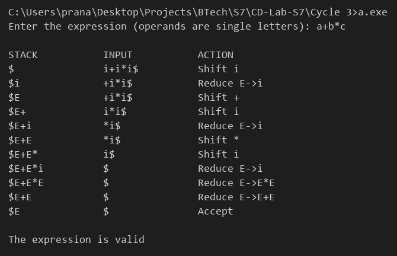

# Compiler Lab Experiment 11

Aim: Develop an operator precedence parser for a given language.

## Algorithm

1. Start.
2. Take the grammar `E -> E+E | E-E | E*E | E/E | (E) | id`. Operands are written as single letters and `id` is represented by `i`.
3. Define the precedence relation between the terminal on top of the stack (`a`) and the current input symbol (`b`) using the function `relation()`:
   - `*` and `/` have higher precedence than `+` and `-`. All operators are left associative.
   - `a < b` or `a = b` means shift, `a > b` means reduce.
4. Read the expression, replace every letter by `i` and add `$` at the end.
5. Initialize the stack with `$`.
6. Find `a`, the topmost terminal on the stack (ignore `E`), and `b`, the current input symbol.
7. If both are `$` and the stack contains only `$E`, accept the string.
8. If `a < b` or `a = b`, push `b` on the stack and move to the next input symbol (shift).
9. If `a > b`, reduce the handle on top of the stack: `i` to `E`, `E op E` to `E` or `( E )` to `E` (reduce).
10. If no relation exists or the handle is not valid, display an error and stop.
11. Repeat Steps 6–10 and display the stack, input and action in every step.
12. Stop.

## Program

```c
#include <stdio.h>
#include <string.h>
#include <ctype.h>
char stack[50], input[50];
int isop(char c)
{
    return c == '+' || c == '-' || c == '*' || c == '/';
}
int rank(char c)
{
    return (c == '*' || c == '/') ? 2 : 1;
}
char relation(char a, char b)
{
    if (a == 'i')
        return (b == 'i' || b == '(') ? 'e' : '>';
    if (isop(a))
    {
        if (b == 'i' || b == '(')
            return '<';
        if (isop(b))
            return (rank(a) >= rank(b)) ? '>' : '<';
        return '>';
    }
    if (a == '(')
    {
        if (b == 'i' || b == '(' || isop(b))
            return '<';
        if (b == ')')
            return '=';
        return 'e';
    }
    if (a == ')')
        return (b == 'i' || b == '(') ? 'e' : '>';
    if (b == 'i' || b == '(' || isop(b))
        return '<';
    if (b == '$')
        return 'a';
    return 'e';
}
int main()
{
    int i = 0, k, top = 0, t, ok = 0;
    char a, b, rel;
    printf("Enter the expression (operands are single letters): ");
    scanf("%s", input);
    for (k = 0; input[k] != '\0'; k++)
        if (isalpha(input[k]))
            input[k] = 'i';
    strcat(input, "$");
    stack[0] = '$';
    stack[1] = '\0';
    printf("\n%-15s %-15s %s\n", "STACK", "INPUT", "ACTION");
    while (1)
    {
        t = top;
        while (stack[t] == 'E')
            t--;
        a = stack[t];
        b = input[i];
        rel = relation(a, b);
        printf("%-15s %-15s ", stack, input + i);
        if (rel == 'a')
        {
            if (top == 1 && stack[1] == 'E')
            {
                printf("Accept\n");
                ok = 1;
            }
            else
                printf("Error\n");
            break;
        }
        else if (rel == '<' || rel == '=')
        {
            printf("Shift %c\n", b);
            stack[++top] = b;
            stack[top + 1] = '\0';
            i++;
        }
        else if (rel == '>')
        {
            if (stack[top] == 'i')
            {
                printf("Reduce E->i\n");
                stack[top] = 'E';
            }
            else if (top >= 2 && stack[top] == 'E' && isop(stack[top - 1]) && stack[top - 2] == 'E')
            {
                printf("Reduce E->E%cE\n", stack[top - 1]);
                top -= 2;
                stack[top] = 'E';
                stack[top + 1] = '\0';
            }
            else if (top >= 2 && stack[top] == ')' && stack[top - 1] == 'E' && stack[top - 2] == '(')
            {
                printf("Reduce E->(E)\n");
                top -= 2;
                stack[top] = 'E';
                stack[top + 1] = '\0';
            }
            else
            {
                printf("Error\n");
                break;
            }
        }
        else
        {
            printf("Error\n");
            break;
        }
    }
    if (ok)
        printf("\nThe expression is valid\n");
    else
        printf("\nThe expression is invalid\n");
}
```

## Output


