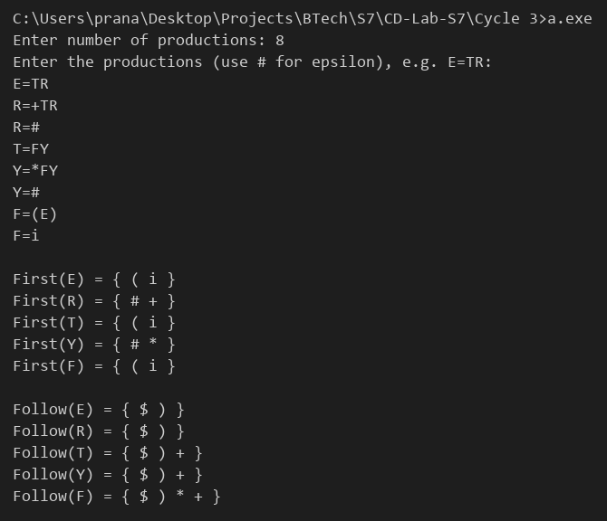

# Compiler Lab Experiment 12

Aim: Write a program to simulate First and Follow of any given grammar.

## Algorithm

1. Start.
2. Read the number of productions `n`.
3. Read each production in the form `A=XYZ`. Uppercase letters are non-terminals, all other symbols are terminals and `#` represents ε.

**To find First:**

4. For each production `A -> X1 X2 ...`, look at the symbols from left to right.
5. If `X1` is a terminal, add it to `First(A)` and stop.
6. If `X1` is a non-terminal, add `First(X1)` (except `#`) to `First(A)`. If `First(X1)` contains `#`, continue with the next symbol, otherwise stop.
7. If all symbols can derive `#`, add `#` to `First(A)`.
8. Repeat Steps 4–7 for all productions until no First set changes.

**To find Follow:**

9. Add `$` to the Follow of the start symbol (left side of the first production).
10. For each production `A -> ... B beta`, look at the symbols after `B` from left to right.
11. If a terminal comes next, add it to `Follow(B)` and stop.
12. If a non-terminal `C` comes next, add `First(C)` (except `#`) to `Follow(B)`. If `First(C)` contains `#`, continue with the next symbol, otherwise stop.
13. If nothing follows `B`, or all symbols after `B` can derive `#`, add `Follow(A)` to `Follow(B)`.
14. Repeat Steps 10–13 for all productions until no Follow set changes.

**Result:**

15. Display the First and Follow sets of every non-terminal.
16. Stop.

## Program

```c
#include <stdio.h>
#include <ctype.h>
#define MAX 20
char prod[MAX][20];
int first[26][128], follow[26][128];
int n;
int add(int set[], int c)
{
    if (set[c])
        return 0;
    set[c] = 1;
    return 1;
}
void findFirst()
{
    int i, k, c, changed, nullable;
    char X;
    do
    {
        changed = 0;
        for (i = 0; i < n; i++)
        {
            nullable = 1;
            for (k = 2; prod[i][k] != '\0'; k++)
            {
                X = prod[i][k];
                if (!isupper(X))
                {
                    changed |= add(first[prod[i][0] - 'A'], X);
                    nullable = 0;
                    break;
                }
                for (c = 0; c < 128; c++)
                    if (first[X - 'A'][c] && c != '#')
                        changed |= add(first[prod[i][0] - 'A'], c);
                if (!first[X - 'A']['#'])
                {
                    nullable = 0;
                    break;
                }
            }
            if (nullable)
                changed |= add(first[prod[i][0] - 'A'], '#');
        }
    } while (changed);
}
void findFollow()
{
    int i, k, m, c, changed, nullable;
    char X, Y;
    add(follow[prod[0][0] - 'A'], '$');
    do
    {
        changed = 0;
        for (i = 0; i < n; i++)
            for (k = 2; prod[i][k] != '\0'; k++)
            {
                X = prod[i][k];
                if (!isupper(X))
                    continue;
                nullable = 1;
                for (m = k + 1; prod[i][m] != '\0'; m++)
                {
                    Y = prod[i][m];
                    if (!isupper(Y))
                    {
                        changed |= add(follow[X - 'A'], Y);
                        nullable = 0;
                        break;
                    }
                    for (c = 0; c < 128; c++)
                        if (first[Y - 'A'][c] && c != '#')
                            changed |= add(follow[X - 'A'], c);
                    if (!first[Y - 'A']['#'])
                    {
                        nullable = 0;
                        break;
                    }
                }
                if (nullable)
                    for (c = 0; c < 128; c++)
                        if (follow[prod[i][0] - 'A'][c])
                            changed |= add(follow[X - 'A'], c);
            }
    } while (changed);
}
void printSet(int set[])
{
    int c;
    printf("{ ");
    for (c = 0; c < 128; c++)
        if (set[c])
            printf("%c ", c);
    printf("}\n");
}
int main()
{
    int i, seen[26] = {0};
    printf("Enter number of productions: ");
    scanf("%d", &n);
    printf("Enter the productions (use # for epsilon), e.g. E=TR:\n");
    for (i = 0; i < n; i++)
        scanf("%s", prod[i]);
    findFirst();
    findFollow();
    printf("\n");
    for (i = 0; i < n; i++)
        if (!seen[prod[i][0] - 'A'])
        {
            seen[prod[i][0] - 'A'] = 1;
            printf("First(%c) = ", prod[i][0]);
            printSet(first[prod[i][0] - 'A']);
        }
    printf("\n");
    for (i = 0; i < 26; i++)
        seen[i] = 0;
    for (i = 0; i < n; i++)
        if (!seen[prod[i][0] - 'A'])
        {
            seen[prod[i][0] - 'A'] = 1;
            printf("Follow(%c) = ", prod[i][0]);
            printSet(follow[prod[i][0] - 'A']);
        }
}
```

## Output


