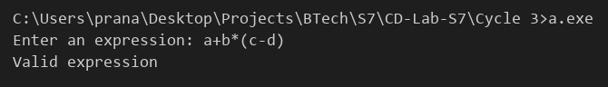

# Compiler Lab Experiment 13

Aim: Construct a recursive descent parser for an expression.

## Algorithm

1. Start.
2. Remove the left recursion from the expression grammar to get:
   - `E -> T E'`
   - `E' -> + T E' | - T E' | ε`
   - `T -> F T'`
   - `T' -> * F T' | / F T' | ε`
   - `F -> ( E ) | id`
3. Write one function for every non-terminal: `E()`, `Ep()`, `T()`, `Tp()` and `F()`. Each function returns `1` on success and `0` on failure.
4. Read the expression into the string `s` and set the position `pos = 0`.
5. `F()`: if the current symbol is a letter or digit, move ahead and return `1`. If it is `(`, move ahead, call `E()` and check for `)`. Otherwise return `0`.
6. `Tp()`: if the current symbol is `*` or `/`, move ahead, call `F()` and then `Tp()`. Otherwise return `1` (ε).
7. `T()`: call `F()` and then `Tp()`.
8. `Ep()`: if the current symbol is `+` or `-`, move ahead, call `T()` and then `Ep()`. Otherwise return `1` (ε).
9. `E()`: call `T()` and then `Ep()`.
10. Call `E()` from `main()`.
11. If `E()` succeeds and the whole string has been read, display `Valid expression`. Otherwise display `Invalid expression`.
12. Stop.

## Program

```c
#include <stdio.h>
#include <ctype.h>
char s[50];
int pos = 0;
int E();
int F()
{
    if (isalnum(s[pos]))
    {
        pos++;
        return 1;
    }
    if (s[pos] == '(')
    {
        pos++;
        if (!E())
            return 0;
        if (s[pos] == ')')
        {
            pos++;
            return 1;
        }
    }
    return 0;
}
int Tp()
{
    if (s[pos] == '*' || s[pos] == '/')
    {
        pos++;
        if (!F())
            return 0;
        return Tp();
    }
    return 1;
}
int T()
{
    return F() && Tp();
}
int Ep()
{
    if (s[pos] == '+' || s[pos] == '-')
    {
        pos++;
        if (!T())
            return 0;
        return Ep();
    }
    return 1;
}
int E()
{
    return T() && Ep();
}
int main()
{
    printf("Enter an expression: ");
    scanf("%s", s);
    if (E() && s[pos] == '\0')
        printf("Valid expression\n");
    else
        printf("Invalid expression\n");
}
```

## Output


