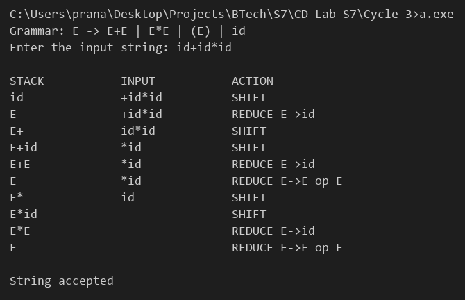

# Compiler Lab Experiment 14

Aim: Construct a Shift Reduce Parser for a given language.

## Algorithm

1. Start.
2. Take the grammar `E -> E+E | E*E | (E) | id`.
3. Read the input string.
4. Initialize an empty stack.
5. Shift the next input symbol on to the stack (`id` is shifted as a single symbol). Display the stack, remaining input and the action.
6. After every shift, check the top of the stack and reduce as long as possible:
   - `id` is reduced to `E`.
   - `E+E` or `E*E` is reduced to `E`.
   - `(E)` is reduced to `E`.
7. Display the stack, remaining input and the action after every reduction.
8. Repeat Steps 5–7 until all the input symbols are read.
9. If the stack contains only the start symbol `E`, display `String accepted`.
10. Otherwise, display `String rejected`.
11. Stop.

## Program

```c
#include <stdio.h>
#include <string.h>
char stack[50], input[50];
int top = -1;
void show(char *action)
{
    int i;
    char buf[100] = "";
    for (i = 0; i <= top; i++)
        if (stack[i] == 'i')
            strcat(buf, "id");
        else
            strncat(buf, &stack[i], 1);
    printf("%-15s %-15s %s\n", buf, input, action);
}
void reduce()
{
    while (1)
    {
        if (top >= 0 && stack[top] == 'i')
        {
            stack[top] = 'E';
            show("REDUCE E->id");
        }
        else if (top >= 2 && stack[top] == 'E' && (stack[top - 1] == '+' || stack[top - 1] == '*') && stack[top - 2] == 'E')
        {
            top -= 2;
            stack[top] = 'E';
            show("REDUCE E->E op E");
        }
        else if (top >= 2 && stack[top] == ')' && stack[top - 1] == 'E' && stack[top - 2] == '(')
        {
            top -= 2;
            stack[top] = 'E';
            show("REDUCE E->(E)");
        }
        else
            break;
    }
}
int main()
{
    char in[50];
    int i = 0;
    printf("Grammar: E -> E+E | E*E | (E) | id\n");
    printf("Enter the input string: ");
    scanf("%s", in);
    strcpy(input, in);
    printf("\n%-15s %-15s %s\n", "STACK", "INPUT", "ACTION");
    while (in[i] != '\0')
    {
        if (in[i] == 'i' && in[i + 1] == 'd')
        {
            stack[++top] = 'i';
            i += 2;
        }
        else
        {
            stack[++top] = (in[i] == 'i') ? '?' : in[i];
            i++;
        }
        strcpy(input, in + i);
        show("SHIFT");
        reduce();
    }
    if (top == 0 && stack[0] == 'E')
        printf("\nString accepted\n");
    else
        printf("\nString rejected\n");
}
```

## Output


