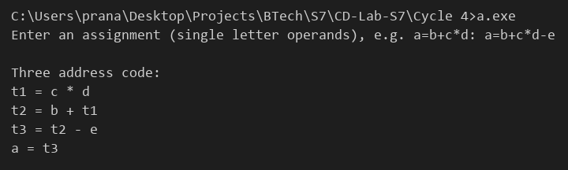

# Compiler Lab Experiment 15

Aim: Implement intermediate code generation for simple expressions.

## Algorithm

1. Start.
2. Read the assignment statement, for example `a=b+c*d`. The left side is the result variable and the right side is the expression.
3. Define the precedence of operators: `*` and `/` have precedence 2, `+` and `-` have precedence 1.
4. Convert the expression to postfix form:
   - Operands are added to the output directly.
   - `(` is pushed on the operator stack. On `)`, operators are popped to the output until `(` is found.
   - For any other operator, pop operators of equal or higher precedence to the output and then push the operator.
   - At the end, pop all the remaining operators to the output.
5. Scan the postfix expression from left to right.
6. If the symbol is an operand, push it on the stack.
7. If the symbol is an operator, pop the two top operands `op2` and `op1`, generate the statement `ti = op1 operator op2` and push the temporary `ti` on the stack. Increment `i`.
8. After the scan, generate the final statement `result = (top of the stack)`.
9. Stop.

## Program

```c
#include <stdio.h>
#include <ctype.h>
#include <string.h>
#define MAX 50
int prec(char c)
{
    if (c == '*' || c == '/')
        return 2;
    if (c == '+' || c == '-')
        return 1;
    return 0;
}
int main()
{
    char in[MAX], post[MAX], ops[MAX], st[MAX][5];
    int i, k = 0, top = -1, sp = -1, t = 1;
    printf("Enter an assignment (single letter operands), e.g. a=b+c*d: ");
    scanf("%s", in);
    for (i = 2; in[i] != '\0'; i++)
    {
        if (isalnum(in[i]))
            post[k++] = in[i];
        else if (in[i] == '(')
            ops[++top] = '(';
        else if (in[i] == ')')
        {
            while (ops[top] != '(')
                post[k++] = ops[top--];
            top--;
        }
        else
        {
            while (top >= 0 && prec(ops[top]) >= prec(in[i]))
                post[k++] = ops[top--];
            ops[++top] = in[i];
        }
    }
    while (top >= 0)
        post[k++] = ops[top--];
    post[k] = '\0';
    printf("\nThree address code:\n");
    for (i = 0; i < k; i++)
    {
        if (isalnum(post[i]))
        {
            st[++sp][0] = post[i];
            st[sp][1] = '\0';
        }
        else
        {
            printf("t%d = %s %c %s\n", t, st[sp - 1], post[i], st[sp]);
            sp--;
            sprintf(st[sp], "t%d", t);
            t++;
        }
    }
    printf("%c = %s\n", in[0], st[sp]);
}
```

## Output


