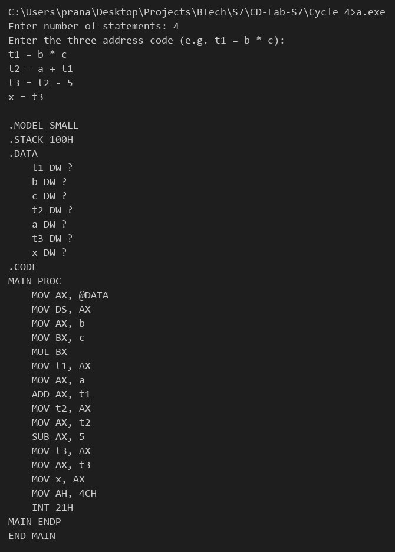

# Compiler Lab Experiment 16

Aim: Implement the back end of the compiler which takes the three address code and produces the 8086 assembly language instructions that can be assembled and run using an 8086 assembler. The target assembly instructions can be simple move, add, sub, jump etc.

## Algorithm

1. Start.
2. Read the number of statements `n` and the three address statements in the form `r = a op b` or `r = a`.
3. For each statement, collect the names of the variables (`r`, `a`, `b`) in a list. Numbers are not added to the list.
4. Display the program header: `.MODEL SMALL`, `.STACK 100H`, `.DATA`.
5. For every variable in the list, display `name DW ?` in the data segment.
6. Display `.CODE`, `MAIN PROC` and the instructions to initialize the data segment (`MOV AX, @DATA` and `MOV DS, AX`).
7. For each three address statement, generate the following code. The first instruction of every statement is `MOV AX, a`.
   - `+` : `ADD AX, b`
   - `-` : `SUB AX, b`
   - `*` : `MOV BX, b` and `MUL BX`
   - `/` : `MOV DX, 0`, `MOV BX, b` and `DIV BX`
   - `=` (copy): no operation instruction is needed.
8. The last instruction of every statement is `MOV r, AX`, which stores the result.
9. Display the program end: `MOV AH, 4CH`, `INT 21H`, `MAIN ENDP` and `END MAIN`.
10. Stop.

## Program

```c
#include <stdio.h>
#include <string.h>
#include <ctype.h>
#define MAX 20
char line[MAX][50], vars[60][10];
int nv = 0;
void addVar(char *s)
{
    int i;
    if (isdigit(s[0]))
        return;
    for (i = 0; i < nv; i++)
        if (strcmp(vars[i], s) == 0)
            return;
    strcpy(vars[nv++], s);
}
int main()
{
    int n, i, count;
    char r[10], a[10], b[10], op;
    printf("Enter number of statements: ");
    scanf("%d", &n);
    getchar();
    printf("Enter the three address code (e.g. t1 = b * c):\n");
    for (i = 0; i < n; i++)
    {
        fgets(line[i], 50, stdin);
        count = sscanf(line[i], "%s = %s %c %s", r, a, &op, b);
        addVar(r);
        addVar(a);
        if (count == 4)
            addVar(b);
    }
    printf("\n.MODEL SMALL\n.STACK 100H\n.DATA\n");
    for (i = 0; i < nv; i++)
        printf("    %s DW ?\n", vars[i]);
    printf(".CODE\nMAIN PROC\n");
    printf("    MOV AX, @DATA\n    MOV DS, AX\n");
    for (i = 0; i < n; i++)
    {
        count = sscanf(line[i], "%s = %s %c %s", r, a, &op, b);
        printf("    MOV AX, %s\n", a);
        if (count == 4)
        {
            if (op == '+')
                printf("    ADD AX, %s\n", b);
            else if (op == '-')
                printf("    SUB AX, %s\n", b);
            else if (op == '*')
                printf("    MOV BX, %s\n    MUL BX\n", b);
            else if (op == '/')
                printf("    MOV DX, 0\n    MOV BX, %s\n    DIV BX\n", b);
        }
        printf("    MOV %s, AX\n", r);
    }
    printf("    MOV AH, 4CH\n    INT 21H\nMAIN ENDP\nEND MAIN\n");
}
```

## Output


